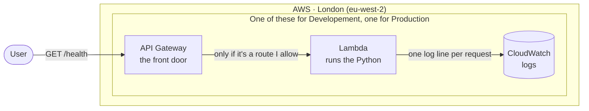
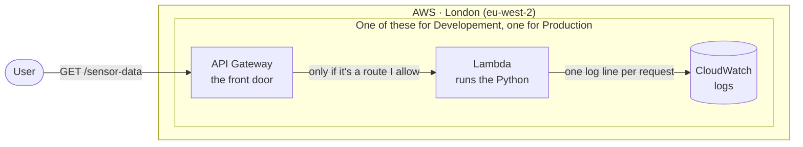
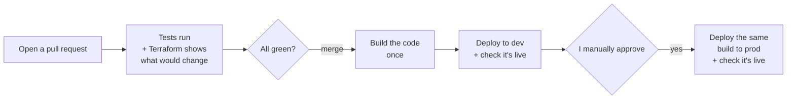

# Sensor Endpoints API 📡

A tiny API with two endpoints, `/health` and `/sensor-data`, running on AWS Lambda.

The API itself is the simple bit. The interesting bit is everything around it: the infrastructure is all Terraform, nothing was built by clicking around the AWS console, and every change goes through GitHub Actions on its way to dev and then prod. Production (Prod) waits for a human, in this case me, to say "yes" first.

## How it works






API Gateway is the front door. It gives the API its URL and only lets in the two routes I've set up. Try `/admin` or `/anything-else` and it's turned away at the door with a 404, without my code ever waking up.

If access one of the allowed Routes, Lambda runs the Python, sends back some JSON and writes a log line.

There are no servers to look after and nothing running when nobody's using it, so it costs next to nothing. There's also no VPC: the API doesn't talk to a database or anything private, so there's nothing to hide behind one. If it ever needed a database, that's something I would change.

## What's where

```
app/            the Python API, its tests, and a little local server for trying it out
infra/
  bootstrap/    the one-off setup everything else relies on
  modules/api/  the API's infrastructure, written once
  envs/dev/     "build that, with dev settings"
  envs/prod/    "build that, with prod settings"
.github/        the pipeline (and Dependabot, who keeps things up to date)
```

## Try it locally

```powershell
py -m venv .venv
.venv\Scripts\Activate.ps1
pip install -r app/requirements-dev.txt

pytest -v                  # run the tests
py app\local_server.py     # then open http://localhost:8000/health
```

The local server pretends to be API Gateway, so you can poke the real handler in your browser before anything goes near AWS.

## Dev and prod

Both environments are built from the same **Terraform** code. The only thing that changes is a small settings file for each one:

| | Dev | Prod |
|---|---|---|
| Log detail | Chatty (`DEBUG`) | Just the important stuff (`INFO`) |
| Logs kept for | 7 days | 30 days |
| Goes live | As soon as it's merged | When I approve it |

Each environment also has its own Terraform state and its own AWS role, so dev can't touch prod, even by accident.

One thing I did on purpose: those settings have **no defaults**. If someone forgets to set one for prod, Terraform stops and complains rather than quietly using a value that was meant for dev.

## From local to production



**When I open a pull request (PR),** the tests run, then Terraform works out exactly what would change in AWS and posts it on the PR. That way I'm reviewing the real impact, not just the code.

**When I merge,** the code is packaged **once**. That same package goes to dev, and the pipeline checks that `/health` is reporting the new version. Only then does prod ask for my approval, and it gets the **exact same package** that just worked in dev.

**A few guard rails:**
- Nothing gets into `main` without a pull request and passing checks, and that includes me.
- Only one deploy runs at a time.
- Terraform locks its state, so two runs can't trip over each other.

**If something goes wrong,** I revert the commit and the pipeline puts the previous version back, through exactly the same steps.

## Keeping it secure

- **No passwords or keys stored anywhere.** GitHub proves who it is to AWS with a short-lived token (OIDC) and gets temporary access that expires within an hour. There's nothing to leak.
- **AWS only trusts this exact repo**, and only for the right environment. The prod role only opens for a deploy that's been approved.
- **Each part only gets what it needs.** The dev pipeline can't touch prod. The running code can only write its own logs. The pipeline can't hand itself extra permissions (I tested that one).
- **Terraform's state is locked away:** encrypted, versioned, never public, and protected from being deleted by accident.
- **Errors stay private.** Users get a polite "something went wrong", and the details go to the logs.

## Settings and secrets

Settings like which environment it is, the log level and the version are passed in by Terraform. Same code everywhere, different settings.

The app doesn't have any secrets. If it ever did, they'd live in AWS Secrets Manager, and only that environment's Lambda would be allowed to read them. Never in the code, and never in the repo.

## Big decisions (and what they cost me)

| I chose… | Because… | The catch |
|---|---|---|
| **Lambda + API Gateway** | Two endpoints don't need a server running 24/7 | Can be slow if not run for a while, and some AWS lock-in. For heavier or long-running work I'd move to containers (ECS Fargate) |
| **No web framework** | Two endpoints, plain Python, nothing extra to install or patch | If the API grew, I'd add one |
| **One AWS account** | Keeps the exercise focused | Dev and prod are separated by names and permissions. Separate accounts would be stronger. |
| **Build once, deploy twice** | Prod gets exactly what was tested in dev | The dev and prod steps in the pipeline are a bit copy and paste |
| **Only the permissions I need** | Every permission has a reason | The first prod deploy failed on one I'd missed. That's least privilege working as intended! |

## Things that went wrong (and what I learned)

Honestly, this was the most educational part:

- **My tests passed everywhere except the pipeline.** A file I needed had never been committed. It only existed on my machine, which is exactly why you run tests on a clean machine.
- **AWS kept saying "not authorised".** Three times. First my rule was checking the wrong thing (a branch instead of an environment). Then it turned out GitHub includes ID numbers for the repo and owner in its token, not just names. Once I printed out what GitHub was actually sending, it was obvious.
- **Prod didn't wait for my approval.** I'd forgotten to add myself as the reviewer. Lesson: test that your safety checks actually stop you.
- **Dependabot opened several PRs at once and they tripped over each other** Trying to add addition features I opened up another error. Dependabot tried to open multiple PR's at the same time. The lock did its job, and now runs wait their turn instead of failing.

## If I had more time

- **Separate AWS accounts** for dev and prod, so they're properly seperated out.
- **Alerts** that tell me when something breaks, rather than me finding out from the logs, something like Zabbix or PRTG.
- **A firewall (WAF) and some login** in front of the API.
- **Put the GitHub settings in Terraform too**, so things like the prod reviewer can't be forgotten again.
- **Tidy up the pipeline**, so dev and prod share one set of steps instead of two copies.

## Setting it up from scratch

There's a small chicken-and-egg problem: the pipeline needs some AWS setup before it can run. That part (`infra/bootstrap`) is applied once, by hand. It creates the bucket where Terraform keeps its state, and the trust between GitHub and AWS. After that, the pipeline does everything.

## Cost

As close to nothing as possible. Nothing runs unless someone calls the API, and there are no servers or other always-on extras. To remove it all, run `terraform destroy` in each environment, then tidy up the bootstrap.